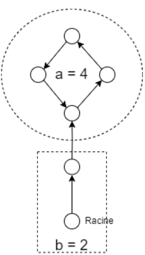

:hardbreaks:
:experimental:
= Seance 1

=== Objectifs opérationnels
*Programmation modulaire*

* Je découpe un programme en plusieurs fonctions 
* Je découpe un programme en plusieurs fichiers 

*Structures*

* Je déclare et utilise une structure correspondant à un besoin 

*Gestion dynamique de la mémoire*

* Je comprends le fonctionnement d'un pointeur 
* Je connais les cas d'utilisation d'un pointeur 
* Je déclare un pointeur et un tableau dynamique 
* Je manipule une liste chainée 

---

== Problème de la raquette

Une liste chainée de longueur n, comprenant une queue de taille b et une boucle de taille a comme suit :  

Chaque élément contient uniquement un pointeur sur l’élément suivant, un pointeur sur la racine vous est donné. 

Donnez un programme qui permet de déterminer a et b pour n'importe quelle liste (sachant a+b< INT_MAX). 

Contraintes : vous pouvez seulement parcourir la liste chainée, pas la cartographier.
